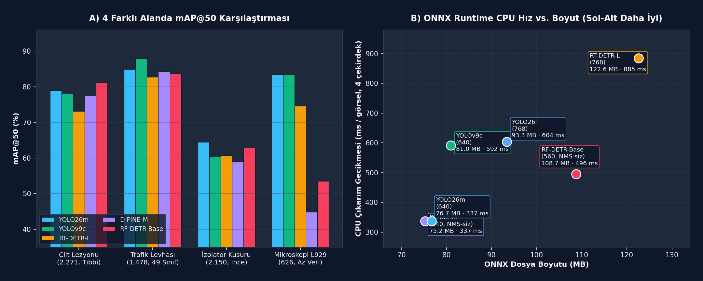

# EVREN Multi-Architecture Object Detection & ONNX CPU Benchmark (2026)

Controlled empirical benchmark comparing **6 object detection architecture families** (**YOLO26**, **YOLO11**, **YOLOv9c**, **RT-DETR-L**, **D-FINE-M**, **RF-DETR-Base**) across **4 distinct computer vision domains** (**24 controlled runs**), paired with **ONNX Runtime CPU latency/size measurements** and a **unified pure-NumPy multi-architecture ONNX decoder**.



---

## Key Empirical Findings

| Domain (Dataset Profile) | Winner | Best `mAP@50` | Best `mAP@50-95` | Core Takeaway |
|---|---|---:|---:|---|
| **Medical Skin Lesions** (`2,271` imgs, `4` cls — fuzzy texture boundaries) | **`RF-DETR-Base` (DINOv2, 560px)** | **`81.17%`** | **`56.80%`** | Outperformed even `YOLO26l @ 768px` (`79.76% / 54.03%`) with `+9.5 pts` higher Precision (`79.23%`). |
| **Directional Traffic Signs** (`1,478` imgs, `49` fine classes) | **`YOLOv9c`** (`640` / `768` px) | **`87.94%`** | **`74.05%`** | PGI architecture led overall; `D-FINE-M` achieved highest Recall (`86.30%`) and tightest Transformer boxes (`71.50%`). |
| **High-Voltage Insulator Defects** (`2,150` imgs, `7` small-defect classes) | **`YOLO26l @ 960px`** | **`66.26%`** | **`28.41%`** | Resolution scaling (`640 -> 768 -> 960`) drove `+12.4 pts` Precision jump (`77.96%`). |
| **Phase-Contrast Microscopy L929** (`626` imgs, `6` dense tiny cell classes) | **`YOLO26m`** (`640px`) | **`83.42%`** | **`63.61%`** | CNN inductive bias dominated low-data dense scenes; `D-FINE-M` stayed at `48.34%` even at `120` epochs. |

---

## ONNX Runtime CPU Benchmark (4 Threads, Median `ms/img`)

| Architecture | Input Tensor | ONNX Size | CPU Median | CPU FPS | Output Contract |
|---|---|---:|---:|---:|---|
| **`D-FINE-M`** | `images [B, 3, 640, 640]` (fixed) | **`75.25 MB`** | **`336.6 ms`** | **`2.97 FPS`** | NMS-free: `logits [B,300,C]` + `boxes [B,300,4]` |
| **`YOLO26m`** | `images [B, 3, H, W]` (dynamic) | `76.66 MB` | `337.4 ms` | `2.96 FPS` | Single tensor `output0 [B, *, anchors]` |
| **`RF-DETR-Base`** | `input [1, 3, 560, 560]` (static) | `108.71 MB` | **`495.9 ms`** | **`2.02 FPS`** | NMS-free: `dets [1,300,4]` + `labels [1,300,C+1]` |
| **`YOLOv9c`** | `images [B, 3, H, W]` (dynamic) | `80.96 MB` | `592.0 ms` | `1.69 FPS` | Single tensor `output0 [B, *, anchors]` |
| **`YOLO26l`** | `images [B, 3, H, W]` (dynamic) | `93.34 MB` | `604.0 ms` | `1.66 FPS` | Single tensor `output0 [B, *, anchors]` |
| **`RT-DETR-L`** | `images [B, 3, H, W]` (dynamic) | `122.63 MB` | `884.7 ms` | `1.13 FPS` | Single tensor `output0 [B, 300, 4+C]` |

---

## Quick Start (Unified ONNX Decoder)

```bash
pip install -e ".[onnx,dev]"
pytest -v
```

```python
from multiarch_onnx import benchmark_onnx_cpu, decode_outputs

stats = benchmark_onnx_cpu("model.onnx", default_imgsz=640, threads=4)
print(stats)
```

---

## Related Open-Source Links
- **Detailed Turkish Engineering Article (Dev.to):** [dev.to/kenantabak](https://dev.to/kenantabak)
- **Open Multi-Architecture Models & Parquet Benchmark Dataset (Hugging Face):** [huggingface.co/kenantabak](https://huggingface.co/kenantabak)
- **GitHub Portfolio:** [github.com/kenantabak](https://github.com/kenantabak)
