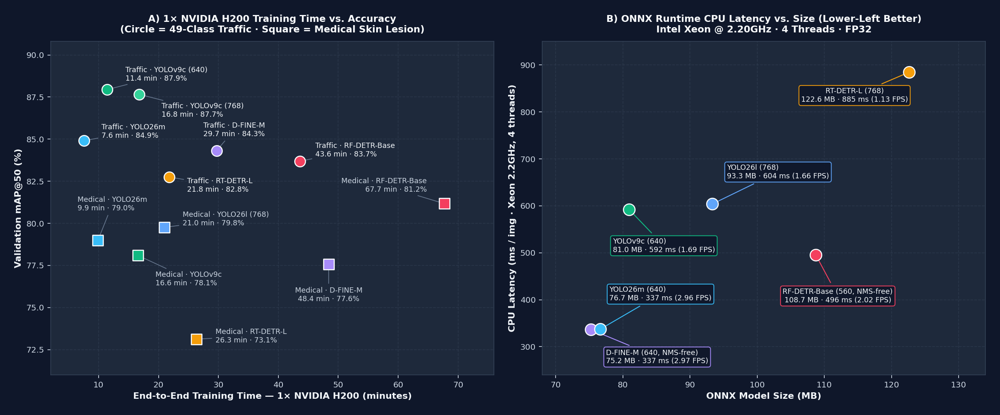

# EVREN Multi-Architecture Object Detection & ONNX CPU Benchmark (2026)

Controlled empirical benchmark comparing **6 object detection architecture families** (**YOLO26**, **YOLO11**, **YOLOv9c**, **RT-DETR-L**, **D-FINE-M**, **RF-DETR-Base**) across **4 distinct computer vision domains** (**24 controlled runs**, **`10.97` total H200 GPU-hours**, `0` failed jobs), paired with **ONNX Runtime CPU latency/size measurements**, **peak VRAM telemetry**, and a **unified pure-NumPy multi-architecture ONNX decoder**.




---

## Experimental Hardware & Measurement Protocol

Because wall-clock training duration and inference latency depend directly on hardware, every run reports **both absolute time on fixed hardware and the architecture-to-architecture relative multiplier** (normalized to `YOLO26m = 1.0×` on each domain):

| Phase | Verified Hardware & Runtime | Protocol |
|---|---|---|
| **Training (24 runs)** | **`1× NVIDIA H200` (`141 GB HBM3e`)**, PyTorch AMP (`gpu_count=1`) | Identical frozen train/val splits per domain; end-to-end wall-clock minutes (`completed_at - started_at`) + peak VRAM telemetry. |
| **ONNX CPU Inference (6 models)** | **`Intel(R) Xeon(R) CPU @ 2.20GHz`**, `onnxruntime` `CPUExecutionProvider`, **4 threads, FP32** | `3` warmup iterations + `10` timed single-image inferences; median latency (`ms/img`) and throughput (`FPS`). |
| **Pre-Release Visual Audit** | Real downloaded `.onnx` weights on held-out / independent unseen test images | Ground-truth vs. ONNX prediction inspection confirming exact preprocessing and tensor decoding contracts. |

---

## Key Empirical Findings (Accuracy × H200 Training Time × Peak VRAM)

### Summary by Domain

| Domain (Dataset Profile) | Winner | `mAP@50` | `mAP@50-95` | `1× H200` Time | Relative Time | Core Takeaway |
|---|---|---:|---:|---:|---:|---|
| **Medical Skin Lesions** (`2,271` imgs, `4` cls — fuzzy texture boundaries) | **`RF-DETR-Base` (DINOv2, 560px)** | **`81.17%`** | **`56.80%`** | `67.7 min` | `6.8×` | Outperformed `YOLO26l @ 768px` (`79.76% / 54.03%`, `21.0 min`) with `+9.5 pts` higher Precision (`79.23%`). |
| **Directional Traffic Signs** (`1,478` imgs, `49` fine classes) | **`YOLOv9c`** (`640` / `768` px) | **`87.94%`** | **`74.05%`** | `11.4` / `16.8 min` | `1.5×` / `2.2×` | Led accuracy while using only `10.2–14.3 GB` VRAM; `D-FINE-M` led Recall (`86.30%`, `29.7 min`). |
| **High-Voltage Insulator Defects** (`2,150` imgs, `7` small-defect classes) | **`YOLO26l @ 960px`** | **`66.26%`** | **`28.41%`** | `28.3 min` | `2.2×` | Resolution scaling (`640 -> 768 -> 960`) drove `+12.4 pts` Precision jump (`77.96%`), beating `74.1 min` `RF-DETR`. |
| **Phase-Contrast Microscopy L929** (`626` imgs, `6` dense tiny cell classes) | **`YOLO26m`** (`640px`) | **`83.42%`** | **`63.61%`** | **`4.8 min`** | **`1.0×`** | CNN inductive bias dominated low-data dense scenes (`4.8 min` vs `51.2 min` & `54.1 GB` peak VRAM for `RF-DETR-Base`). |

### Complete 24-Run Matrix (`1× NVIDIA H200`)

#### 1. Medical Skin Lesions (`2,271` images, `4` classes)

| Architecture | Input / Epochs | `mAP@50` | `mAP@50-95` | `Precision` | `Recall` | `1× H200` Time | Relative | Peak VRAM |
|---|---:|---:|---:|---:|---:|---:|---:|---:|
| **`RF-DETR-Base` (DINOv2)** | `560` / `40` | **`81.17%`** | **`56.80%`** | **`79.23%`** | `74.71%` | `67.7 min` | `6.8×` | `20.0 GB` |
| `YOLO26l` *(Stage 2)* | `768` / `70` | `79.76%` | `54.03%` | `69.74%` | **`79.71%`** | `21.0 min` | `2.1×` | `14.1 GB` |
| `YOLO26m` | `640` / `60` | `79.00%` | `53.14%` | `70.24%` | `78.87%` | **`9.9 min`** | **`1.0×`** | `15.2 GB` |
| `YOLOv9c` | `640` / `60` | `78.09%` | `52.14%` | `71.51%` | `75.60%` | `16.6 min` | `1.7×` | **`10.3 GB`** |
| `D-FINE-M` | `640` / `60` | `77.57%` | `54.40%` | `70.97%` | `76.00%` | `48.4 min` | `4.9×` | — |
| `RT-DETR-L` | `640` / `60` | `73.12%` | `50.57%` | `73.86%` | `74.52%` | `26.3 min` | `2.7×` | `11.8 GB` |

#### 2. Directional Traffic Signs (`1,478` images, `49` classes, `fliplr=0.0`)

| Architecture | Input / Epochs | `mAP@50` | `mAP@50-95` | `Precision` | `Recall` | `1× H200` Time | Relative | Peak VRAM |
|---|---:|---:|---:|---:|---:|---:|---:|---:|
| **`YOLOv9c`** | `640` / `60` | **`87.94%`** | `73.48%` | `84.10%` | `83.01%` | `11.4 min` | `1.5×` | **`10.2 GB`** |
| **`YOLOv9c`** *(Stage 2)* | `768` / `75` | `87.66%` | **`74.05%`** | `83.38%` | `84.13%` | `16.8 min` | `2.2×` | `14.3 GB` |
| `YOLO26m` | `640` / `60` | `84.91%` | `70.94%` | **`86.06%`** | `76.27%` | **`7.6 min`** | **`1.0×`** | `14.8 GB` |
| `D-FINE-M` | `640` / `60` | `84.32%` | `71.50%` | `83.37%` | **`86.30%`** | `29.7 min` | `3.9×` | — |
| `RF-DETR-Base` | `560` / `40` | `83.69%` | `70.60%` | `76.79%` | `79.75%` | `43.6 min` | `5.7×` | `19.5 GB` |
| `RT-DETR-L` | `768` / `57` | `82.75%` | `71.44%` | `80.21%` | `82.56%` | `21.8 min` | `2.9×` | `15.1 GB` |

#### 3. High-Voltage Insulator Defects (`2,150` images, `7` classes)

| Architecture | Input / Epochs | `mAP@50` | `mAP@50-95` | `Precision` | `Recall` | `1× H200` Time | Relative | Peak VRAM |
|---|---:|---:|---:|---:|---:|---:|---:|---:|
| **`YOLO26l`** *(Stage 2)* | **`960`** / `70` | **`66.26%`** | **`28.41%`** | **`77.96%`** | `61.90%` | `28.3 min` | `2.2×` | `21.2 GB` |
| `YOLO26m` | `768` / `60` | `64.49%` | `27.91%` | `65.52%` | `64.29%` | **`12.7 min`** | **`1.0×`** | `21.1 GB` |
| `RF-DETR-Base` | `560` / `40` | `62.86%` | `24.36%` | `64.83%` | `65.63%` | `74.1 min` | `5.8×` | `19.5 GB` |
| `RT-DETR-L` | `768` / `60` | `60.73%` | `25.34%` | `71.50%` | `61.10%` | `33.9 min` | `2.7×` | `15.1 GB` |
| `YOLOv9c` | `768` / `60` | `60.36%` | `26.46%` | `54.83%` | **`67.20%`** | `19.1 min` | `1.5×` | **`14.2 GB`** |
| `D-FINE-M` | `640` / `60` | `58.85%` | `25.47%` | `61.83%` | `62.29%` | `41.8 min` | `3.3×` | — |

#### 4. Phase-Contrast Microscopy L929 (`626` images, `6` classes — low-data dense cells)

| Architecture | Input / Epochs | `mAP@50` | `mAP@50-95` | `Precision` | `Recall` | `1× H200` Time | Relative | Peak VRAM |
|---|---:|---:|---:|---:|---:|---:|---:|---:|
| **`YOLO26m`** | `640` / `60` | **`83.42%`** | **`63.61%`** | **`85.52%`** | **`77.88%`** | **`4.8 min`** | **`1.0×`** | `17.9 GB` |
| `YOLOv9c` | `640` / `60` | `83.41%` | `63.34%` | `84.26%` | `76.25%` | `6.6 min` | `1.4×` | **`11.6 GB`** |
| `RT-DETR-L` | `640` / `60` | `74.62%` | `57.04%` | `82.63%` | `75.08%` | `12.9 min` | `2.7×` | `20.6 GB` |
| `RF-DETR-Base` | `560` / `40` | `53.51%` | `37.78%` | `62.71%` | `56.16%` | `51.2 min` | `10.6×` | **`54.1 GB`** |
| `D-FINE-M` *(Stage 2, 2× ep)* | `640` / `120` | `48.34%` | `35.29%` | `62.60%` | `49.50%` | `32.7 min` | `6.8×` | — |
| `D-FINE-M` *(Stage 1)* | `640` / `60` | `44.86%` | `31.49%` | `51.37%` | `51.33%` | `18.3 min` | `3.8×` | — |

> **VRAM takeaway:** On dense L929 microscopy (~43 cells/image), `RF-DETR-Base` spiked to **`54.1 GB` peak VRAM** (exceeding consumer 24 GB GPUs at default batch settings) while taking `10.6×` longer than `YOLO26m` (`4.8 min`). Across all 4 domains, `YOLOv9c` maintained the lowest peak VRAM footprint (`10.2–14.3 GB`).

---

## ONNX Runtime CPU Benchmark (`Intel Xeon @ 2.20GHz`, 4 Threads, FP32)

| Architecture | Input Tensor | ONNX Size | CPU Median | CPU FPS | Preprocessing & Output Contract |
|---|---|---:|---:|---:|---|
| **`D-FINE-M`** | `images [B, 3, 640, 640]` (fixed) | **`75.25 MB`** | **`336.6 ms`** | **`2.97 FPS`** | `[0,1]` RGB · NMS-free `logits [B,300,C]` + `boxes [B,300,4]` |
| **`YOLO26m`** | `images [B, 3, H, W]` (dynamic) | `76.66 MB` | `337.4 ms` | `2.96 FPS` | `[0,1]` RGB · Single tensor `output0 [B, *, anchors]` |
| **`RF-DETR-Base`** | `input [1, 3, 560, 560]` (static) | `108.71 MB` | **`495.9 ms`** | **`2.02 FPS`** | **ImageNet mean/std** · NMS-free `dets [1,300,4]` + `labels [1,300,C+1]` (`0..C-1` fg, `C` bg) |
| **`YOLOv9c`** | `images [B, 3, H, W]` (dynamic) | `80.96 MB` | `592.0 ms` | `1.69 FPS` | `[0,1]` RGB · Single tensor `output0 [B, *, anchors]` + NMS |
| **`YOLO26l`** | `images [B, 3, H, W]` (dynamic) | `93.34 MB` | `604.0 ms` | `1.66 FPS` | `[0,1]` RGB · Single tensor `output0 [B, *, anchors]` |
| **`RT-DETR-L`** | `images [B, 3, H, W]` (dynamic) | `122.63 MB` | `884.7 ms` | `1.13 FPS` | `[0,1]` RGB · Single tensor `output0 [B, 300, 4+C]` |

> **Critical ONNX Trap:** Omitting ImageNet mean/std normalization on `RF-DETR-Base` ONNX causes ~3× Recall degradation even when boxes appear plausible; `D-FINE-M` uses plain `[0, 1]` RGB scaling.

---

## Quick Start (Unified Pure-NumPy ONNX Decoder)

```bash
pip install -e ".[onnx,dev]"
pytest -v
```

```python
from multiarch_onnx import benchmark_onnx_cpu, decode_outputs

stats = benchmark_onnx_cpu("model.onnx", default_imgsz=640, threads=4)
print(stats)
```

---

## Scope & Reproducibility Note

All metrics, wall-clock training durations (`1× NVIDIA H200`), peak VRAM figures, and CPU latencies (`Intel Xeon @ 2.20GHz`, 4 threads) reflect our controlled experimental setup on these four public datasets and should be treated as empirical observations rather than universal guarantees. Absolute times scale with GPU/CPU generation, driver/runtime versions, and batch/dataloader settings; validate on your own data and target hardware before production deployment.

## Related Open-Source Links
- **Turkish Engineering Deep-Dive (Dev.to):** [CNN vs Transformer: 4 Farklı Alanda 24 Kontrollü Nesne Tespiti Deneyi ve ONNX CPU Gerçeği](https://dev.to/kenantabak/cnn-vs-transformer-4-farkli-alanda-24-kontrollu-nesne-tespiti-deneyi-ve-onnx-cpu-gercegi-2jn)
- **Structured Parquet Benchmark Dataset (Hugging Face):** [kenantabak/evren-multiarch-cv-onnx-benchmark](https://huggingface.co/datasets/kenantabak/evren-multiarch-cv-onnx-benchmark)
- **Visually Audited ONNX Models (Hugging Face):** [rfdetr-base-skin-lesion-detection-tr](https://huggingface.co/kenantabak/rfdetr-base-skin-lesion-detection-tr) · [dfine-m-traffic-signs-49-tr](https://huggingface.co/kenantabak/dfine-m-traffic-signs-49-tr) · [yolov9c-traffic-signs-49-tr](https://huggingface.co/kenantabak/yolov9c-traffic-signs-49-tr)
- **EVREN Community Report:** [EVREN Forum — Benchmarks](https://evren.ssyz.org.tr/forum/t/01a21368-9112-7302-a3e7-aeb33cead110)
